<div align="center">

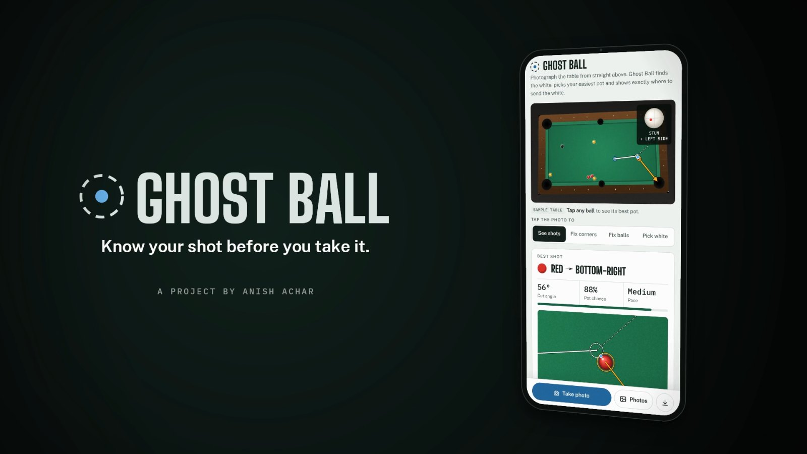

# Ghost Ball

**Take one photo of a pool table. Ghost Ball finds your easiest pot and draws it.**

[**Try it live**](https://anishachar.com/ghost-ball/) · [Watch the 80-second reel](https://anishachar.com/#projects/ghostball) · [Project write-up](https://anishachar.com/#projects/ghostball)


</div>

---

## Why I built it

To put it simply, I was sick of my friends beating me at pool. The more I played, the more the same shots kept coming up, and once I'd worked through the geometry it all made sense: every pot comes down to one spot the white has to reach, the **ghost ball**. So I built a program that just shows you the shot instead of boring you with the details.

## What it does

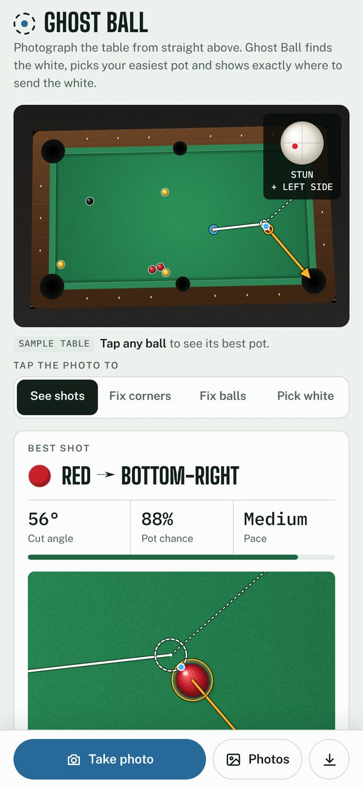

1. **One photo from above.** Ghost Ball finds the table, flattens the perspective and picks out every ball, including the white.
2. **Every pot, ranked.** Straight pots, banks, kicks and combinations, each ranked by the chance *you'd* make it at your level (beginner, club or strong).
3. **The best shot, drawn.** Where to aim, where to strike the white (stun, top or screw) and where the white goes next.
4. **Fix it yourself.** Drag a corner, add a missed ball or tap the white if the vision gets something wrong.

It all runs in the browser on your phone. **The photo never leaves your device.** It supports UK 8-ball (reds/yellows) and US (solids/stripes).

<br clear="right">

## How it works

From one photo to one shot in eight steps. Each step fixes one problem and runs straight into the next.

| # | Problem | Fix |
|---|---|---|
| 01 | The photo is at an angle | Find the cloth, fit a line to each cushion, intersect them, then flatten the table with a **homography** (a 3×3 matrix solved from the four corners by Gaussian elimination) onto an exact 2:1 table |
| 02 | Balls touch | A **distance transform** gives one peak per ball, so touching balls still separate. Brightness and hue then name each one: white, black, reds/yellows or solids/stripes |
| 03 | Aiming at the ball doesn't pot it | Work backwards from the pocket to the **ghost ball**: where the white must be at contact. Cuts over 80° are refused as too thin to judge |
| 04 | A pocket isn't a point | The two jaws give a **pocket window** of directions that drop; bisection works it back through the collision to a range of aims for the white |
| 05 | Nobody hits the exact line | Model aim error as a normal distribution sized to your level. The share that lands inside the window is the **pot chance** |
| 06 | No straight pot | **Unfold the table**: mirror the pocket (bank) or the white (kick) across the cushion, and the straight-pot maths works unchanged |
| 07 | A ball in the way | **Combinations**: work the window back twice, through both collisions |
| 08 | Where does the white end up? | Tangent-line physics plus spin (I = ⅖mr²) to follow the white to the first cushion or ball, avoiding in-offs |

<p align="center">
  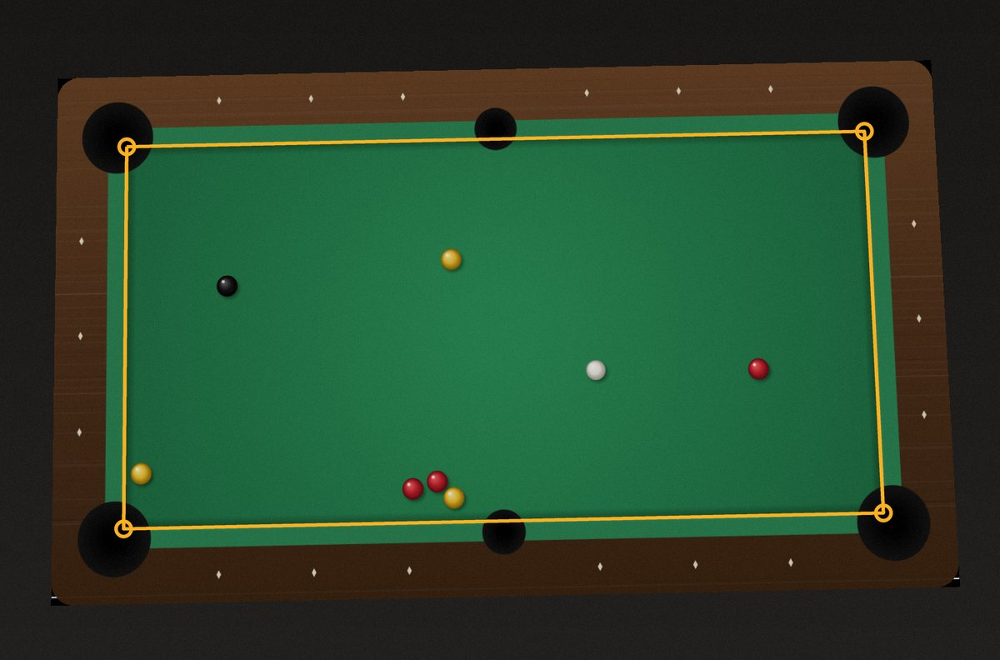
  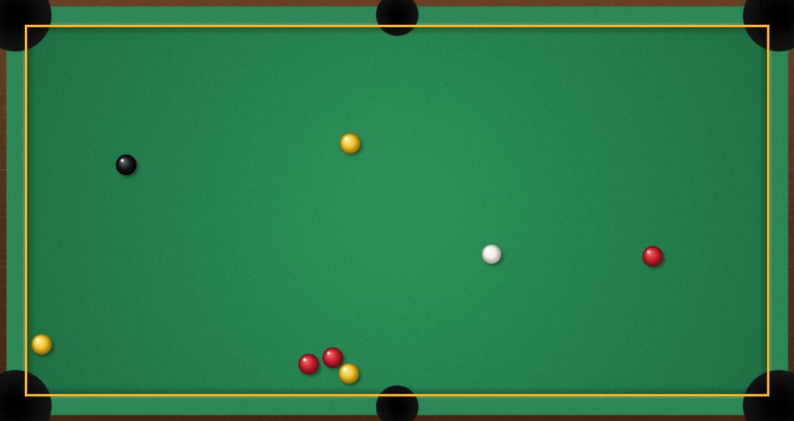
  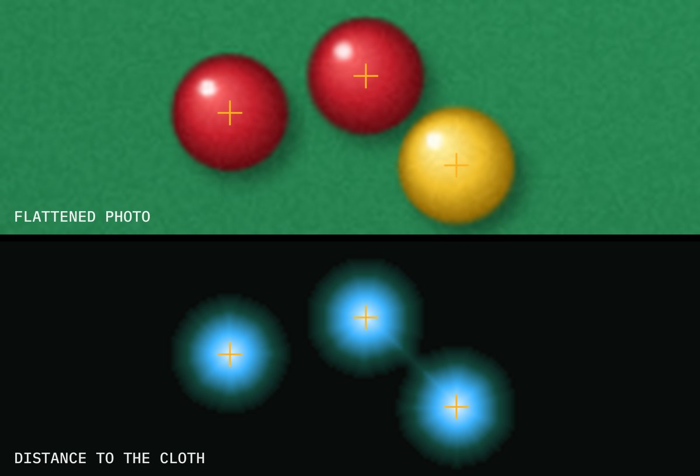
  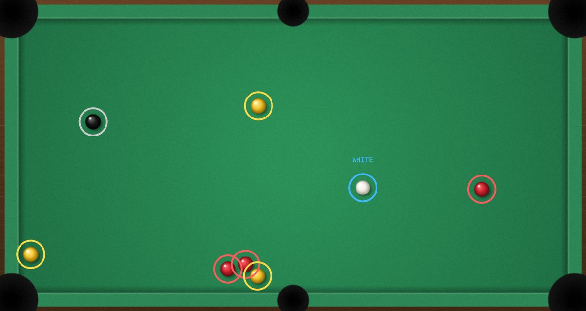
  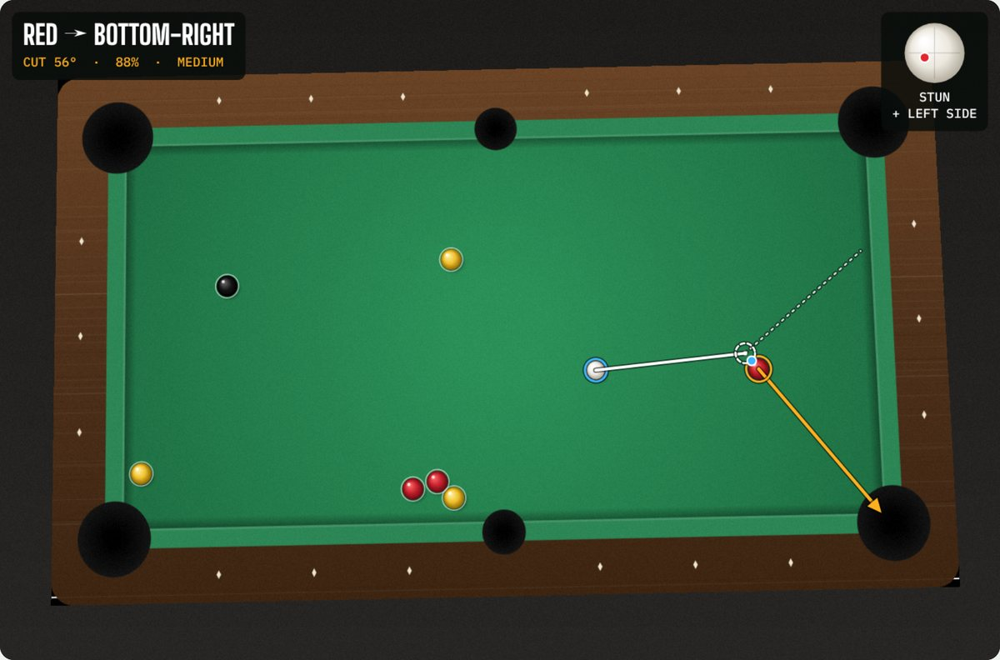
  <br><sub>Photo → flattened → distance map → balls found → best shot (the app's own working on its sample table)</sub>
</p>

### Every type of shot

<p align="center">
  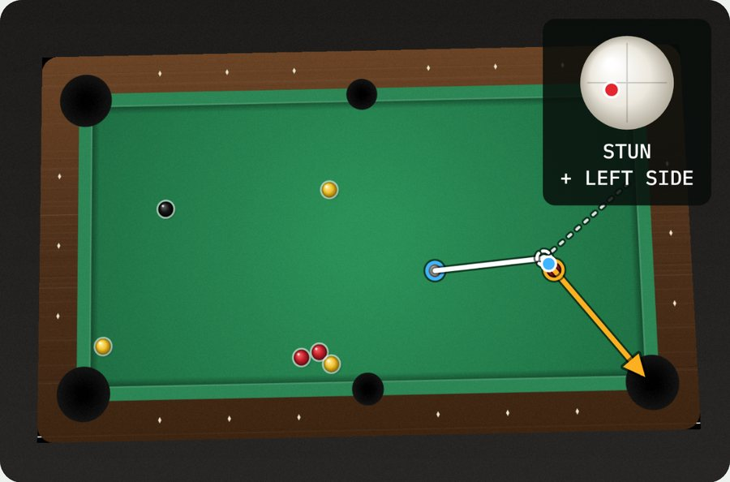
  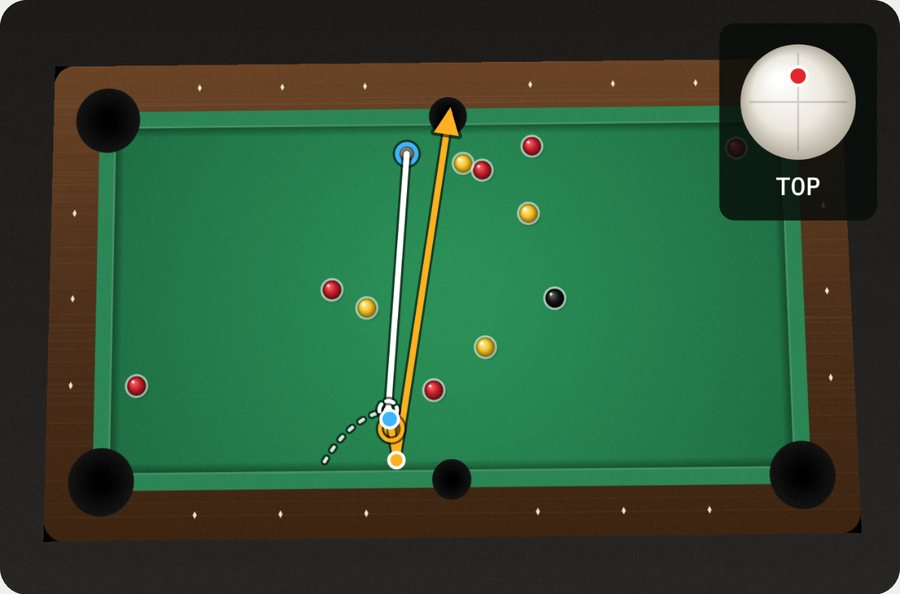
  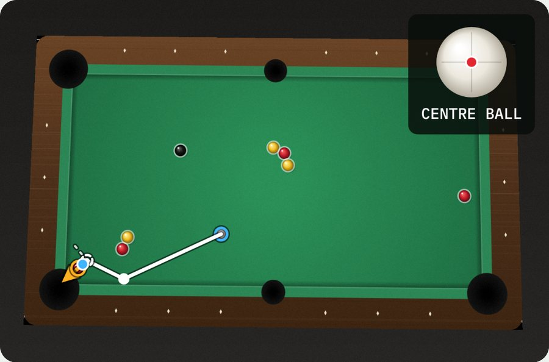
  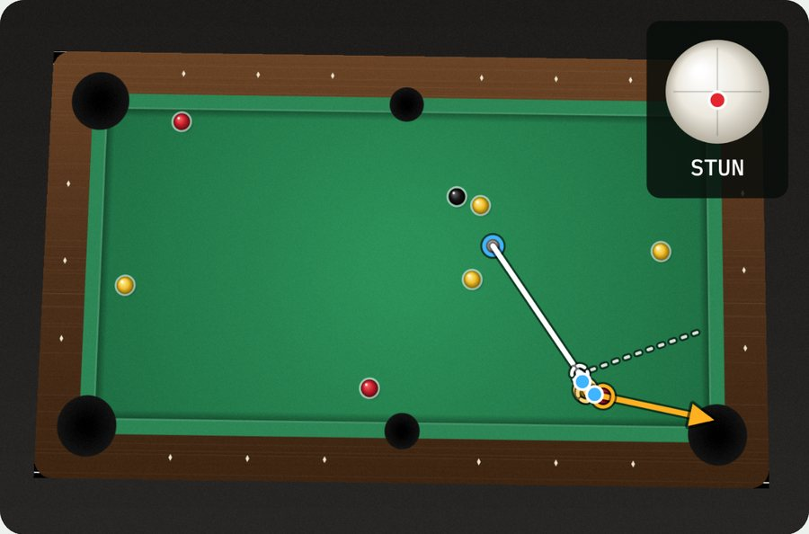
  <br><sub>Straight · Bank · Kick · Combination</sub>
</p>

## Run it locally

It's a single HTML file with no build step and no libraries (no OpenCV).

```bash
git clone https://github.com/Anish-Achar/ghost-ball.git
```

Then open `index.html` in a browser. It starts on a sample table with the best shot already drawn. At a real table, open it on your phone and use **Take photo**.

## Project structure

```
ghost-ball/
├── index.html      # the whole app: vision, solver, physics and UI
├── fonts/          # self-hosted fonts (no third-party requests)
├── favicon.svg
└── docs/images/    # screenshots used in this README
```

## Limitations and next steps

- The photo needs to be taken from roughly straight above, with all four corner pockets in frame.
- The error spreads behind each skill level are my own estimates. Next is logging real shots and fitting them, so the percentages are measured rather than modelled.

---

<sub>Built by <a href="https://anishachar.com">Anish Achar</a>. Part of my <a href="https://github.com/Anish-Achar">portfolio</a>.</sub>
